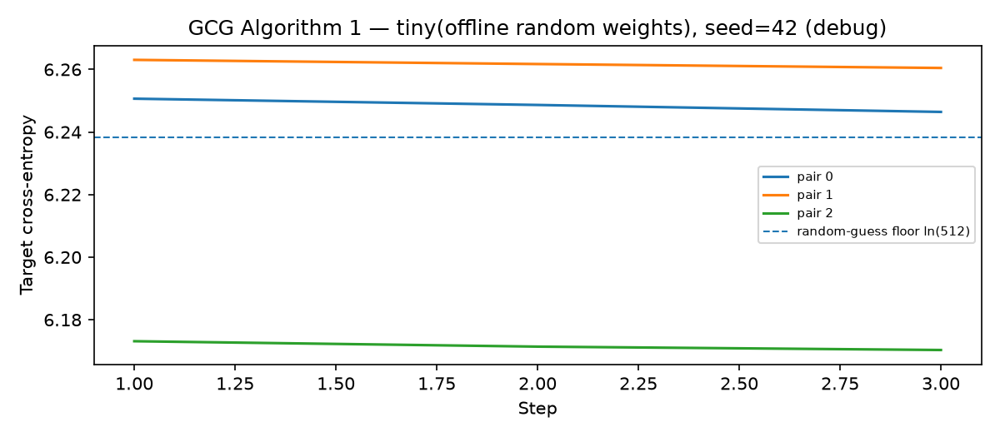
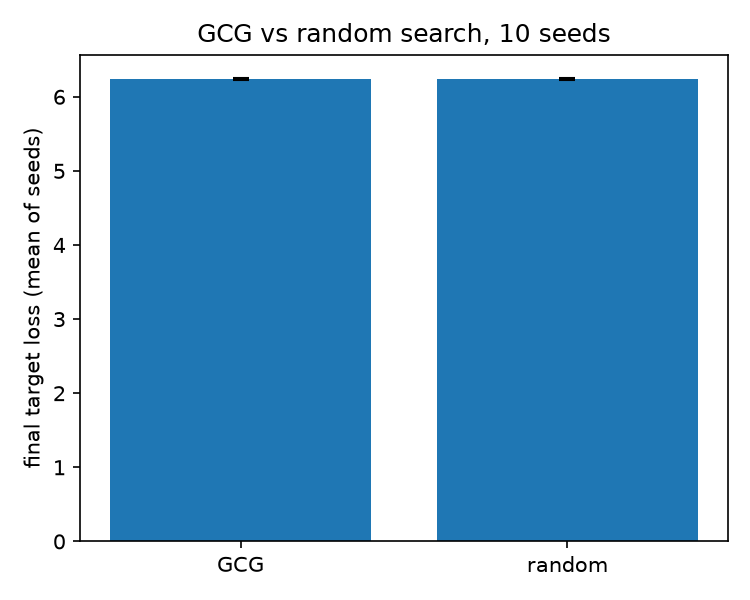
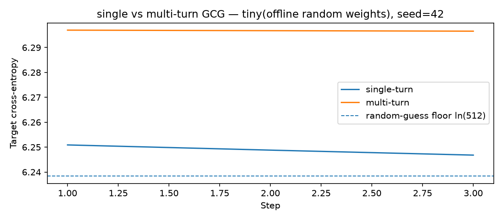
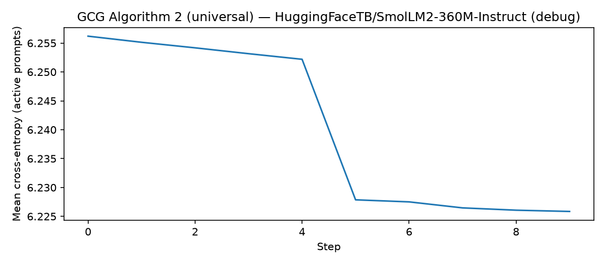
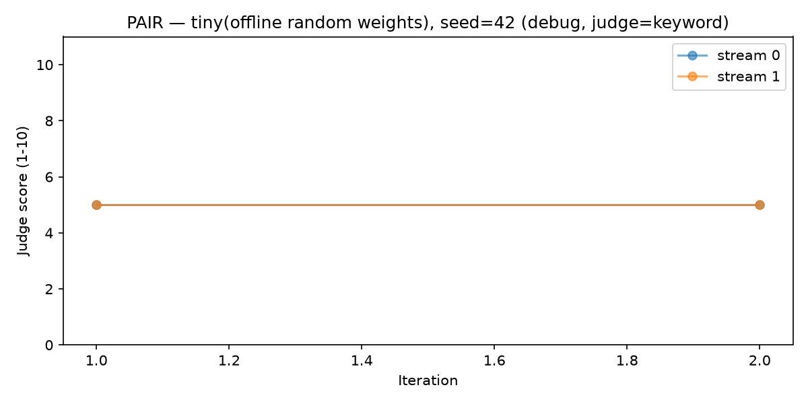
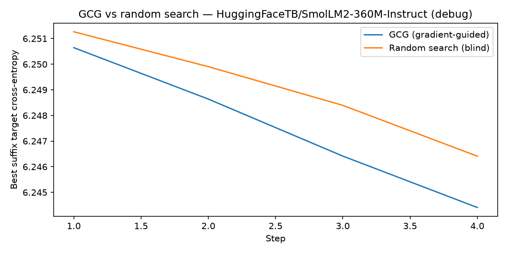

# GCG from Scratch — Greedy Coordinate Gradient Attacks for Learning & Research

A from-scratch implementation of **GCG** (*Greedy Coordinate Gradient*), the
jailbreak attack from
[*Universal and Transferable Adversarial Attacks on Aligned Language Models*
(Zou et al., 2023)](https://arxiv.org/abs/2307.15043), plus its black-box
counterpart **PAIR** — built to understand what happens under the hood, not to
call a library.

> **Why this is alignment-relevant:** GCG shows that refusal behaviour in
> aligned models is not a robust property — a short token block can move the
> model off it, and that block transfers. Defending against the attack requires
> being able to run it.

**Status:** ✅ harness complete and validated · ⏳ **no real-model attack run yet**

---

## Read this before trusting any number below

| Claim | Status |
|---|---|
| The GCG / PAIR / baseline / transfer / defence code paths are numerically correct | ✅ **Verified** — smoke test 7/7, KV-cache equal to full forward to ~1e-9 |
| *Attacks work on aligned models* (ASR, transfer, cost per success) | ❌ **Not tested** — every recorded run is on a 2-layer randomly-initialised model, which has no refusal behaviour to bypass |

**No jailbreak has succeeded in this repository.** Every ASR in `results/` is
0%, and that is expected rather than a finding: a random-weight model cannot be
jailbroken. Run records now label this explicitly (`model_kind: tiny_random`,
`random_weights: true`) and print the `ln(vocab)` loss floor next to the loss
curve, because a loss sitting at that floor is a precise statement that the
optimiser achieved nothing.

Two consequences worth stating plainly:

* A comparison like "GCG beats random search" in this repo measures whether the
  *optimiser* moves the loss in the right direction. It is not a jailbreak result.
* The results table below is empty of real-model numbers **by intention**, not
  by omission. See [`DESIGN.md`](DESIGN.md) for how each module works and
  [`kaggle/`](kaggle/) for how the real runs are executed on free-tier GPU.

---

## What's implemented

- **Algorithm 1 — per-prompt attack** (`src/algorithm1.py`): one-hot gradient
  proxy → top-k candidate substitutions → vectorised single-token mutations →
  re-tokenisation filter → mini-batched scoring → greedy update, with a
  **KV-cache** for the fixed prompt prefix.
- **Algorithm 2 — universal attack** (`src/algorithm2.py`): one suffix for many
  prompts, per-prompt gradient normalisation, **progressive prompt schedule**,
  held-out generalisation evaluation.
- **Multi-turn attack** (`src/multiturn.py`, `experiments/run_multiturn.py`):
  scripted escalation conversation built from the model's own replies, with the
  suffix optimised against the goal as the final user turn; reports single-turn
  vs multi-turn ASR side by side. Limitations are documented in the module.
- **Evaluation harness** (`src/evaluate.py`): paper-style **prefix-match ASR**,
  refusal-rate heuristic, generation, perplexity.
- **Defence baseline** (`src/defense.py`): perplexity-based detection of
  adversarial suffixes (optimised vs. random vs. natural-language controls).
- **Baselines** (`src/baselines.py`): gradient-blind **random search** with an
  identical mutation budget — the ablation that justifies calling this
  gradient-guided. Measured across 10 seeds
  (`experiments/run_seed_variance.py`): GCG wins 10/10, by +0.0075 nats, i.e.
  **0.12% of the loss value**.
- **Cross-model transfer** (`experiments/run_transfer.py`): optimise on model A,
  carry the suffix over as *text*, re-tokenise for model B, compare against both
  the unoptimised suffix and a suffix optimised directly on B.
- **PAIR — black-box counterpart** (`src/pair.py`): an attacker LLM iteratively
  rewrites a natural-language prompt using the target's responses and a judge
  score as feedback. Reuses the GCG harness end to end, which is what makes the
  perplexity contrast (GCG = gibberish, PAIR = fluent) a measurement.
- **Run provenance & cost accounting** (`src/provenance.py`): records the model
  that was *actually* loaded, forward-pass counts, wall-clock, seconds/step and
  money. `cost_per_success_usd` is `None` — not `0.0` — when nothing succeeded.
- **Offline smoke tests** (`src/tiny_model.py`, `experiments/run_smoke.py`): a
  tiny random model plus a locally-trained tokenizer exercise every code path in
  seconds, including a numerical proof that the KV-cache matches the full
  forward.

## Repository structure

```
src/
  algorithm1.py        # per-prompt GCG
  algorithm2.py        # universal / multi-prompt GCG
  multiturn.py         # escalation conversation + single vs multi-turn comparison
  token_manager.py     # chat-template layout, loss slices, re-tokenisation filter
  kv_cache.py          # KV-cache for the fixed prompt prefix
  evaluate.py          # generation, prefix-match ASR, refusal heuristic, perplexity
  defense.py           # perplexity-based defence baseline
  baselines.py         # gradient-blind random-search baseline
  pair.py              # PAIR: black-box, LLM-driven refinement
  provenance.py        # what model was really used + cost accounting
  data.py              # AdvBench loader (HF hub, with an offline fallback)
  model.py             # model/tokenizer loading, optional 4-bit
  tiny_model.py        # tiny offline model for smoke tests
  config.py            # debug / paper presets
experiments/
  run_smoke.py         # end-to-end pipeline validation (CPU, no downloads)
  run_algorithm1.py    # Algorithm 1 attack + in-domain/transfer ASR + cost
  run_control.py       # no-attack control: is any of it the suffix's doing?
  run_algorithm2.py    # universal attack + held-out generalisation + cost
  run_multiturn.py     # multi-turn vs single-turn comparison
  run_baselines.py     # GCG vs random search, same budget
  run_transfer.py      # cross-model suffix transfer
  run_defense.py       # perplexity defence baseline
  run_pair.py          # PAIR experiment
  run_seed_variance.py # effect size + CI for the gradient-vs-random question
  build_report.py      # generates docs/index.html from the run records
data/
  advbench_sample.jsonl  # 30-pair offline fallback (full AdvBench pulls from the hub)
  benign_pairs.jsonl     # safe demo pairs
kaggle/
  real_model_runbook.ipynb  # free-tier GPU runbook for the real experiment matrix
  README.md            # setup, quota discipline, pitfalls
tests/                 # 35 unit tests (metrics, provenance, multi-turn)
results/
  reports/             # method reports + machine-readable run records
  plots/               # loss curves
docs/
  index.html           # generated results page (GitHub Pages ready)
DESIGN.md              # how each module works, and why it is built that way
Dockerfile             # CPU image; `docker run` re-runs the smoke test + tests
.github/workflows/     # CI: tests + smoke test + end-to-end runner on every push
LICENSE                # MIT
```

## Quickstart

```bash
pip install -r requirements.txt

# 0. Containerised version of steps 1-2 (no GPU needed)
docker build -t gcg-scratch . && docker run --rm gcg-scratch

# 1. Validate the whole pipeline offline (CPU, seconds, no downloads)
python -m experiments.run_smoke
python -m unittest discover -s tests        # 35 unit tests

# 2. Offline pipeline demos on the tiny random model
python -m experiments.run_seed_variance --seeds 10     # effect size + CI, ~8s
python -m experiments.run_algorithm1 --tiny --benchmark
python -m experiments.run_algorithm1 --tiny --benchmark --per-prompt --num-prompts 3
python -m experiments.run_control    --tiny --benchmark --num-prompts 4
python -m experiments.run_algorithm2 --tiny --benchmark --held-out 2
python -m experiments.run_multiturn  --tiny --benchmark --num-prompts 4
python -m experiments.run_baselines  --tiny --benchmark
python -m experiments.run_transfer   --tiny --benchmark
python -m experiments.build_report             # rebuild docs/index.html

# 3. Real runs — see kaggle/README.md for the free-tier GPU setup
python -m experiments.run_algorithm1 --preset paper --benchmark \
    --model Qwen/Qwen2.5-1.5B-Instruct --load-in-4bit --steps 500 --num-prompts 25
python -m experiments.run_algorithm2 --preset paper --benchmark \
    --model Qwen/Qwen2.5-1.5B-Instruct --load-in-4bit --steps 500 \
    --num-prompts 25 --held-out 5
python -m experiments.run_transfer --preset paper --benchmark --load-in-4bit \
    --model Qwen/Qwen2.5-1.5B-Instruct \
    --target-model HuggingFaceTB/SmolLM2-1.7B-Instruct
python -m experiments.run_multiturn --preset paper --benchmark \
    --model Qwen/Qwen2.5-1.5B-Instruct --load-in-4bit --steps 500 \
    --num-prompts 10 --n-prior-turns 2
```

Presets (`src/config.py`): `debug` (CPU-friendly) and `paper`
(20-token suffix · top-k 256 · search width 512).

**On "the paper's values":** suffix length, top-k and search width are the
paper's. **250 steps is not** — the official
[`llm-attacks`](https://github.com/llm-attacks/llm-attacks) config uses
`n_steps = 500` for individual attacks (250 is nanoGCG's default), and the PAIR
paper ran GCG for 500 iterations for a comparable query budget. Use
`--steps 500` for anything you intend to compare with published ASR numbers.

## Cost accounting

"Cost per successful attack" is a number the job descriptions in this area
actually ask for, so every runner reports it — in units that do not depend on
which GPU you rented:

| Field | Meaning |
|---|---|
| `gradient_forwards` | one backward pass per optimisation step |
| `candidate_forwards` | forward passes spent scoring candidates (fewer than `steps × search_width`, because the filter drops candidates) |
| `total_forwards`, `seconds_per_step` | hardware-independent cost |
| `cost_per_success_usd` | money; **`null` when there were no successes**, with `undefined_reason` set |
| `forwards_per_success` | the hardware-independent analogue |

On free-tier compute pass `--gpu-rate-usd-per-hour 0.0` (the default) and compare
`total_forwards` between runs instead. Reporting `0` for cost-per-success at 0%
ASR would read as "attacks are free", which is the opposite of the finding.

## Pipeline validation

From `python -m experiments.run_smoke` (seed 0 — full record in
`results/reports/smoke_results.json`):

| Check | Result |
|---|---|
| KV-cache vs. full forward (gradients) | max diff **1.4e-09** ✅ |
| KV-cache vs. full forward (candidate losses) | max diff **4.8e-07** ✅ |
| Algorithm 1 optimisation runs end-to-end | ✅ |
| Algorithm 2 universal schedule (prompts ramp 1→2→3) | ✅ |
| Multi-turn suffix optimisation + evaluation | ✅ |
| ASR / refusal metrics computed | ✅ (0% on random weights — expected) |
| Perplexity defence baseline | ✅ |
| GCG beats random search (same budget) | ✅ directionally — see below |
| Cross-model transfer pipeline (different tokenizers) | ✅ |
| PAIR black-box refinement loop | ✅ |

**What "GCG beats random search" is worth.** The single-seed gap (6.2481 ≤
6.2553) is too small to interpret alone, so it was re-measured across 10 seeds
with `experiments/run_seed_variance.py` (10 steps × 16 candidates, tiny model —
deliberately small budget). GCG won **10/10 seeds**, mean paired improvement
**+0.0075 nats**, 95% CI ≈ [+0.0060, +0.0090] — the gradient signal helps
consistently, but the effect is **0.12% of the loss value**. Evidence that the
optimiser step works as implemented. Not evidence of a jailbreak.

## Results

**Every number below is on a randomly-initialised model, and every ASR is 0%.**
That is not a finding about aligned models — a random-weight model has no refusal
behaviour to bypass. It is a statement about the test rig, and it is stated first
on purpose.

The full generated table, rebuilt from the JSON records on every run, is
[`docs/index.html`](docs/index.html) (publishable as a GitHub Pages site):

```bash
python -m experiments.build_report     # regenerate from results/reports/generated/
```

To publish it as a live link: **Settings → Pages → Source: `main` / `/docs`**, and
the page appears at `https://<user>.github.io/<repo>/`. It is regenerated from the
run records, so it cannot drift from the data or claim more than the runs proved.

### Loss curve vs. the random-guess floor

The dashed line is `ln(vocab)`. A loss sitting on it means the suffix is not
biting — which is exactly what these runs show, and why the floor is drawn on
every plot.



### Does the gradient help at all? 10 seeds, identical budget



GCG wins 10/10 seeds, mean paired improvement +0.0075 nats,
95% CI ≈ [+0.0060, +0.0090] — **0.12% of the loss value**. Real, reproducible,
and tiny. Reported at that size rather than rounded up to "GCG wins".

### Multi-turn vs. single-turn, same goal



Both settings fail. The verdict string the runner writes is literally
`"no attack succeeded in either setting; the comparison is uninformative until at
least one side breaks the model"` — a null result stated as one.

<details>
<summary>More figures</summary>





</details>

### Real-model table — the template, still empty

The runs that would fill this need a GPU and have not been executed yet. The
columns are fixed in advance so the shape of the evidence is decided before the
numbers exist:

| Model | Prompts | Method | ASR | n_successes | total_forwards | Source |
|---|---|---|---|---|---|---|
| _pending_ | | | | | | |

Every row must carry its `n`. A rate without `n` is not a result.

## Known defects & corrections

- **Run records mislabelled the model (fixed).** Records wrote `cfg.model_id`
  verbatim, so a `--tiny` run recorded itself as
  `HuggingFaceTB/SmolLM2-360M-Instruct`. Those runs were never SmolLM2: the tiny
  model's vocab is 512, so uniform guessing floors the loss at `ln(512) = 6.238`
  and every recorded loss sat at ~6.25, whereas a real SmolLM2 (vocab ~49k)
  floors at ~10.8. `src/provenance.py` now records the model actually loaded, and
  `tests/test_provenance.py` pins it.
- **ASR metric was lenient (fixed).** `is_target_prefix_match` scored a response
  that is merely a *prefix of the target* (e.g. `"Sure, here is a"`) as a
  successful jailbreak, which would inflate ASR on real models. Fixed, with
  regression tests in `tests/test_metrics.py`. No recorded result changed (all
  ASR was already 0%).
- **`paper` preset runs 250 steps; the official config uses 500.** Use
  `--steps 500` for published-comparable numbers.
- **`run_transfer.py` had no `--load-in-4bit`** — a 7–8B source model silently
  would not fit a 16GB card, which blocked the transfer experiment. Added.
- **The refusal metric is a regex heuristic** with at least one documented false
  positive (a partial answer opening with a refusal phrase). Cross-check with a
  judge model before publishing a refusal rate.
- **The perplexity defence is unvalidated on real models.** Smooth-LLM-style
  attacks were designed specifically to defeat it; the original comment claiming
  it "cleanly separates" gibberish was unsupported and is now a hypothesis.

## Roadmap

- [ ] Paper-scale runs on real aligned models; fill the results table (GPU).
- [x] Cost/query accounting per run, with honest handling of 0 successes.
- [x] Multi-turn (3-turn) attack variant.
- [x] Run provenance that records the model actually loaded.
- [x] Transfer runner supports 4-bit for both models.
- [x] Offline benchmark fallback extended to 30 pairs.
- [ ] HarmBench-compatible judge + dataset (currently AdvBench + a keyword judge).
- [ ] Stronger defences: smooth-perplexity, windowed PPL; compare detection rates.
- [ ] GCG variants (MMA, Faster-GCG) as drop-in optimisers.
- [ ] Goal-conditioned escalation scripts for the multi-turn attack.

## References

- Zou et al., 2023 — [arXiv:2307.15043](https://arxiv.org/abs/2307.15043)
- Chao et al., 2023 — [PAIR, arXiv:2310.08419](https://arxiv.org/abs/2310.08419)
- Mazeika et al., 2024 — [HarmBench, arXiv:2402.04249](https://arxiv.org/abs/2402.04249)
- [llm-attacks](https://github.com/llm-attacks/llm-attacks) ·
  [nanoGCG](https://github.com/GraySwanAI/nanoGCG) ·
  [PAIR (official)](https://github.com/patrickrchao/JailbreakingLLMs)

## Responsible use

This project exists to **understand and harden** aligned models. Default configs
use benign goals; the bundled benchmark strings are standard red-team evaluation
data (AdvBench-style). Use it only against models you are authorised to test.
Don't use this material to cause harm.
